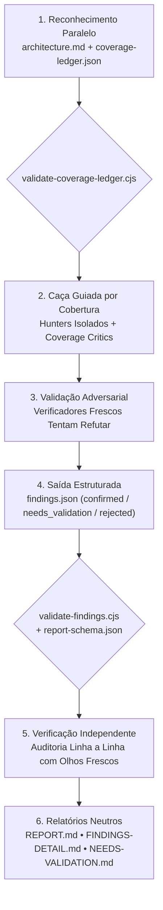

# 🛡️ Auditoria de Segurança: Skill Multi-Agente em 6 Fases & Framework de 60 Controles

<div align="center">

[](LICENSE)
[-0051c3.svg)](skills/security-audit/SKILL.md)
[-success.svg)](skills/security-audit/)
[-orange.svg)](https://owasp.org/www-project-api-security/)
[-red.svg)](https://genai.owasp.org/llm-top-10/)
[](docs/checklist-auditoria-60-controles.md)
[](https://csrc.nist.gov/publications/detail/sp/800-207/final)

**Plataforma aberta e autossuficiente para auditoria de segurança assistida por agentes de IA, descoberta determinística de vulnerabilidades e engenharia defensiva em aplicações web, APIs, bancos de dados, nuvem, protocolos, apps nativos e sistemas de IA.**

[Visão Geral](#-visão-geral) •
[Instalação da Skill](#-instalação-rápida-agent-skill) •
[Motor de 6 Fases](#-motor-de-auditoria-multi-agente-em-6-fases) •
[10 Domínios de Caça](#-os-10-domínios-especializados-de-caça) •
[60 Controles Defensivos](#-catálogo-dos-60-controles-de-segurança-v30) •
[Validadores CLI](#-validadores-determinísticos-zero-dependência) •
[Licença e Créditos](#-créditos-e-licença)

</div>

---

## 📌 Visão Geral

O desenvolvimento acelerado por IA generativa, *vibecoding*, microsserviços e agentes autônomos expandiu drasticamente a superfície de ataque moderna — combinando falhas clássicas (**BOLA/IDOR**, **Request Smuggling**, **SQLi**, **Race Conditions**, **Corrupção de Memória**) com vetores emergentes (**Injeção Indireta de Prompt**, **Falhas de Action-Binding em HITL**, **PoisonedRAG**, **Confusão de Identidade em MCP** e **Denial of Wallet**).

Auditorias genéricas baseadas em um único prompt sofrem de dois problemas crônicos: **cobertura incompleta** e **excesso de falsos positivos** (desvios cosméticos de checklist reportados como vulnerabilidades críticas).

Este repositório resolve ambos os desafios unificando duas frentes complementares em **Português do Brasil**:

1. **🔬 Skill Multi-Agente de Auditoria (`skills/security-audit/`)**: orquestra subagentes isolados através de **6 fases determinísticas** — mapeamento de arquitetura, *Coverage Ledger* auditável, ondas de caça com críticos independentes, validação adversarial (onde um agente fresco tenta *refutar* cada achado), saída estruturada em JSON validada por schema e relatórios neutros. Baseada e expandida a partir do [`cloudflare/security-audit-skill`](https://github.com/cloudflare/security-audit-skill).
2. **🧱 Framework Prescritivo de Engenharia Defensiva ([`seguranca-hibrida-projetos-ia-api-bancos.md`](seguranca-hibrida-projetos-ia-api-bancos.md))**: especificação operacional **v3.0** com **60 controles técnicos** (*Inspecionar → Corrigir → Verificar*) para guiar desenvolvedores e agentes implementadores na remediação cirúrgica na camada autoritativa.

---

## ⚡ Instalação Rápida (Agent Skill)

Instale a skill `security-audit` diretamente em seu agente de codificação (Claude Code, Google Antigravity, Cursor, Codex, Windsurf, Roo Code) usando o [Skills CLI](https://skills.sh):

```bash
# Instalar no projeto atual
npx skills add https://github.com/vmateus17-lab/auditoria-de-seguranca \
  --skill security-audit

# Instalar globalmente para o seu usuário
npx skills add https://github.com/vmateus17-lab/auditoria-de-seguranca \
  --skill security-audit \
  --global
```

### Como Acionar no seu Agente

Aponte seu agente para o repositório que deseja revisar e peça em linguagem natural:

```text
Execute uma auditoria de segurança completa nesta base de código (perfil standard) e salve o relatório em ~/audits/meu-projeto
```

```text
Encontre vulnerabilidades de segurança em ./src/api focando em controle de acesso e multi-tenancy
```

- **Modo de Orientação (`Guidance Mode` — padrão):** ativado automaticamente para perguntas de segurança, revisões rápidas de PR ou triagem pontual, sem gravar arquivos externos.
- **Modo de Auditoria Completa (`Full Audit Mode`):** ativado em pedidos explícitos de auditoria completa/pentest de código, executando todas as 6 fases em diretório isolado (`~/security-audit-skill/<repo>/run-<N>`).
- **Modo Auditoria + Remediação Autorizada:** quando você deseja que o agente também implemente os patches no código e crie os testes de regressão, utilize o prompt direto com o documento mestre:

```text
Leia integralmente seguranca-hibrida-projetos-ia-api-bancos.md e aplique suas instruções ao projeto atual.
Audite as fronteiras de confiança sem falsos positivos; implemente as correções mínimas na camada
autoritativa do servidor; valide com testes negativos, de limite e positivos; e gere o relatório completo
cobrindo os 60 controles e eventuais pendências externas (needs_validation).
```

---

## 🔬 Motor de Auditoria Multi-Agente em 6 Fases



### Princípios de Rigor Probatório

- **Validação Adversarial Obrigatória:** O agente que verifica um candidato na Fase 3 **jamais** é o agente que o encontrou na Fase 2.
- **Somente Violações Reais de Fronteira:** Desvios teóricos de checklist ou ausência de uma segunda camada redundante (*defense-in-depth*) viram notas de hardening, nunca falsas vulnerabilidades.
- **Separação Estrita entre Certeza e Prioridade:**
  - `confirmed`: exige trace completo (`entrypoint → propagation → sink`) e resultado local delimitado em sandbox. Recebe severidade onde `overall_severity` nunca excede o impacto demonstrado (`critical`, `high`, `medium`, `low`, `informational`).
  - `needs_validation`: hipótese fundamentada no código que depende de fato externo não observável localmente (WAF, IAM na nuvem, proxy, runtime). **Não recebe severidade especulativa**, registrando `blockers` exatos e plano seguro de verificação.
  - `rejected`: candidato refutado, preservado para impedir retrabalho em execuções incrementais (*additive runs*).
- **Isolamento de Sandbox Imposto pelo SO:** Execução local sem rede externa, ambiente limpo por allowlist, alvo somente-leitura, escrita restrita a `scratch/` e promoção atômica anti-symlink (`O_NOFOLLOW`, `fstat`) para `artifacts/`.
- **Perfis Escaláveis (`quick`, `standard`, `deep`):** ajustam a amplitude das ondas e granularidade do ledger com controle determinístico de orçamento de agentes (*cost budget*), sem jamais reduzir a barra de evidência.

👉 Consulte os detalhes em [**Guia da Metodologia em 6 Fases**](docs/guia-metodologia-6-fases.md).

---

## 🎯 Os 10 Domínios Especializados de Caça

Além das classes fundamentais em [`ATTACK-CLASSES.md`](skills/security-audit/ATTACK-CLASSES.md) (*Injection*, *Access control*, *Resource & file handling*, *Cryptography & secrets*, *Business logic*, *Feature abuse*, *Chained vulnerabilities*, *Wildcard* e *Obvious things*), a skill conta com 10 guias profundos selecionados sob demanda na Fase 1:

| Guia em `skills/security-audit/` | Escopo Técnico de Caça |
| :--- | :--- |
| [`AI-AND-LLM.md`](skills/security-audit/AI-AND-LLM.md) | Injeção indireta em RAG, vazamento de contexto cross-tenant, envenenamento de memória persistente, *confused deputy*, falhas de *action-binding* em HITL, divergência schema/dispatcher e confusão de identidade MCP. |
| [`WEB-PROTOCOL-AND-AUTH.md`](skills/security-audit/WEB-PROTOCOL-AND-AUTH.md) | HTTP Request Smuggling/Desync, Web Cache Poisoning, Cache Deception, confiança em `Host`/`X-Forwarded-*`, CSRF, fixação de sessão, JWT, OAuth/OIDC, SAML, MFA step-up, Passkeys/WebAuthn, account linking e mTLS. |
| [`CLIENT-SIDE.md`](skills/security-audit/CLIENT-SIDE.md) | DOM XSS, DOM Clobbering, Prototype Pollution + *gadget chains*, `postMessage` inseguro, Cross-Site WebSocket Hijacking, Service Worker scope/cache confusion, XS-Leaks e Clickjacking. |
| [`DATA-ISOLATION-AND-LIFECYCLE.md`](skills/security-audit/DATA-ISOLATION-AND-LIFECYCLE.md) | BOLA multi-tenant, colisão de chaves compostas, divergência RLS vs queries *unscoped*, *ACL drift* em caches/índices/vetores, vazamento em exportação/logs, bypass de *soft-delete* e restauração de estados revogados. |
| [`CLOUD-AND-DEPLOYMENT.md`](skills/security-audit/CLOUD-AND-DEPLOYMENT.md) | Excesso de privilégio IAM/IRSA, confusão cross-account, SSRF para IMDS, bypass de proxy/Service Mesh, exposição de contêiner/host, drift de precedência em Helm/Terraform, Signed URLs e spoofing de eventos cloud. |
| [`SUPPLY-CHAIN-AND-RELEASE.md`](skills/security-audit/SUPPLY-CHAIN-AND-RELEASE.md) | Dependency confusion, inputs mutáveis de build, injeção em expressões de CI/CD, `pull_request_target` inseguro, contaminação de cache/artifacts entre jobs, substituição de digest e rollback de atualizações. |
| [`PROTOCOLS-RPC-AND-MESSAGING.md`](skills/security-audit/PROTOCOLS-RPC-AND-MESSAGING.md) | Divergências de framing Protobuf/gRPC/Thrift, mismatch envelope vs payload, streams RPC sem autorização por item, isolamento de tópicos/DLQ, entregas duplicadas e aceitação de eventos fora de ordem. |
| [`RESOURCE-EXHAUSTION-AND-AVAILABILITY.md`](skills/security-audit/RESOURCE-EXHAUSTION-AND-AVAILABILITY.md) | Complexidade superlinear/ReDoS, bombas de descompressão, amplificação de queries, vazamento de descritores/conexões, trabalho órfão pós-cancelamento, desequilíbrio pré-auth e *poison pills* em filas. |
| [`DESKTOP-MOBILE-AND-LOCAL-IPC.md`](skills/security-audit/DESKTOP-MOBILE-AND-LOCAL-IPC.md) | Sequestro de custom schemes/deep links, confusão de origem em bridges WebView/Electron, componentes Android/iOS exportados, sockets Unix/Named Pipes/XPC sem autenticação de par e TOCTOU em helpers locais. |
| [`MEMORY-SAFETY-AND-BINARY.md`](skills/security-audit/MEMORY-SAFETY-AND-BINARY.md) | Leitura/escrita OOB, integer overflow/truncamento, confusão de unidades, Use-After-Free, Type Confusion, corridas de referência, contratos FFI/ABI, hijacking de loaders binários, JIT e *double-fetch* em kernel. |

---

## 🧱 Catálogo dos 60 Controles de Segurança (v3.0)

Para engenharia defensiva, arquitetura segura e remediação direta, o documento mestre [`seguranca-hibrida-projetos-ia-api-bancos.md`](seguranca-hibrida-projetos-ia-api-bancos.md) organiza **60 controles obrigatórios**:

| Família | Identificadores | Qtde | Foco de Implementação e Hardening |
| :--- | :--- | :---: | :--- |
| **Aplicações e APIs** | `APP01`–`APP20` | 20 | Argon2id, OAuth 2.1 + PKCE, BOLA/BFLA/Mass Assignment, SQLi/Command/XSS, SSRF anti-IMDS, Zip Slip, Rate Limiting IETF, Locks de Concorrência, GraphQL Trusted Queries, Headers HTTP e TLS 1.3. |
| **IA, Agentes e RAG** | `AI01`–`AI10` | 10 | Delimitação anti-Prompt Injection, sanitização PII/ZDR, quebra da Tríade Letal, **HITL com Action-Binding**, Safetensors/AI-BOM, anti-PoisonedRAG, tetos RPM/TPM, CoVe, anti-Vec2Text e saída não confiável. |
| **Bancos de Dados** | `DB01`–`DB08` | 8 | Segregação DDL/DML/IA, PostgreSQL `FORCE ROW LEVEL SECURITY`, TDE/CLE AES-256-GCM, PgBouncer `DISCARD ALL`, allowlists em ORMs, anti-NoSQLi, isolamento de bancos vetoriais e Backup 3-2-1-1-0 WORM. |
| **Integração IA → API → DB** | `INT01`–`INT03` | 3 | Identidade autenticada injetada pelo backend em canais (Web/WhatsApp), ferramentas atômicas com schemas fechados e isolamento multi-tenant de memória e cache semântico. |
| **Infra & DevSecOps** | `INF01`–`INF06` | 6 | Contêineres Distroless non-root, Kubernetes PSS Restricted + eBPF, IaC scanning, CI/CD SLSA com pinning SHA-256/Cosign/OIDC, Vault efêmero, ZTNA 3-tier + mTLS e CSPM. |
| **Hardening por Stack** | `STK01`–`STK04` | 4 | WordPress/PHP seguro, React/Next.js (Server Actions protegidas individualmente e SSR limpo), Node/Python/Go resilientes e servidores/clientes **MCP** isolados. |
| **Protocolos, Client, IPC e Memória** | `PRO01`–`PRO03`, `CLI01`, `IPC01`, `MEM01` | 6 | Anti-Request Smuggling e Cache Deception, WebAuthn/Passkeys e Step-Up Binding, gRPC/Filas/DLQ idempotentes, DOM Clobbering/Service Workers/XS-Leaks, Bridges WebView/IPC Local e Memória/FFI com Sanitizers. |
| **Governança e Privacidade** | `GOV01`–`GOV03` | 3 | Conformidade LGPD (prazo ANPD de 3 dias úteis) e GDPR (72h) com propagação de exclusão em cópias derivadas, resposta a incidentes MITRE ATLAS (*Kill Switch*) e AI Red Teaming contínuo. |

---

## 🧪 Validadores Determinísticos Zero-Dependência

Os artefatos gerados nas auditorias completas são validados mecanicamente por scripts Node.js sem dependências externas, resistentes a symlinks, FIFOs, payloads gigantes e injeção de caracteres ANSI no terminal:

```bash
# Executar os 65 testes unitários da suíte de validadores
node --test skills/security-audit/*.test.cjs

# Validar um Coverage Ledger gerado na auditoria
node skills/security-audit/validate-coverage-ledger.cjs <caminho>/coverage-ledger.json

# Validar um arquivo findings.json contra o report-schema.json
node skills/security-audit/validate-findings.cjs <caminho>/findings.json
```

---

## 📁 Estrutura do Repositório

```text
auditoria-de-seguranca/
├── README.md                                        # Documentação principal do repositório público
├── seguranca-hibrida-projetos-ia-api-bancos.md      # Framework Mestre Consolidado v3.0 (60 controles)
├── skills/
│   └── security-audit/                              # Skill Multi-Agente instalável (npx skills add)
│       ├── SKILL.md                                 # Configuração, sandbox, perfis, orçamento e fluxo
│       ├── RECONNAISSANCE.md                        # Fase 1: Agentes de reconhecimento e Coverage Ledger
│       ├── HUNTING.md                               # Fase 2: Ondas de hunters e Coverage Critics
│       ├── VALIDATION-AND-REPORTING.md              # Fases 3–6: Validação adversarial e relatórios
│       ├── ATTACK-CLASSES.md                        # Classes gerais, encadeadas, Wildcard e Obvious things
│       ├── AI-AND-LLM.md                            # Domínio: IA, LLMs, RAG, Agentes e MCP
│       ├── WEB-PROTOCOL-AND-AUTH.md                 # Domínio: Framing HTTP, Cache, Sessão, OAuth/Passkeys
│       ├── CLIENT-SIDE.md                           # Domínio: DOM, postMessage, Service Workers e XS-Leaks
│       ├── DATA-ISOLATION-AND-LIFECYCLE.md          # Domínio: Multi-tenancy, cópias derivadas e exclusão
│       ├── CLOUD-AND-DEPLOYMENT.md                  # Domínio: IAM, IaC, Kubernetes, Mesh e Serverless
│       ├── SUPPLY-CHAIN-AND-RELEASE.md              # Domínio: Dependências, CI/CD, SLSA e Atualizadores
│       ├── PROTOCOLS-RPC-AND-MESSAGING.md           # Domínio: gRPC, Protobuf, Brokers, Filas e Ordenação
│       ├── RESOURCE-EXHAUSTION-AND-AVAILABILITY.md  # Domínio: ReDoS, Amplificação, Leaks e Cotas
│       ├── DESKTOP-MOBILE-AND-LOCAL-IPC.md          # Domínio: Mobile/Desktop, WebViews, Deep Links e IPC
│       ├── MEMORY-SAFETY-AND-BINARY.md              # Domínio: C/C++/Rust unsafe, FFI/ABI, Loaders e Kernel
│       ├── report-schema.json                       # JSON Schema oficial dos vereditos de auditoria
│       ├── validate-coverage-ledger.cjs             # Validador zero-dependência do coverage-ledger.json
│       ├── validate-coverage-ledger.test.cjs        # Testes automatizados do validador de cobertura
│       ├── validate-findings.cjs                    # Validador zero-dependência do findings.json
│       └── validate-findings.test.cjs               # Testes automatizados do validador de achados
├── docs/
│   ├── checklist-auditoria-60-controles.md          # Checklist operacional das 6 fases + 60 controles
│   ├── guia-metodologia-6-fases.md                  # Guia visual da orquestração multi-agente e perfis
│   ├── guia-integracao-agentes-ia.md                # Integração com Antigravity, Claude, Cursor, Copilot
│   └── modelo-relatorio-auditoria.md                # Template padronizado v3.0 de relatório técnico
├── .github/
│   ├── workflows/
│   │   ├── markdown-lint.yml                        # CI: Testes dos validadores Node.js + Markdownlint
│   │   └── security-scan.yml                        # CI: Escaneamento com TruffleHog e Trivy
│   ├── ISSUE_TEMPLATE/
│   └── PULL_REQUEST_TEMPLATE.md
├── CONTRIBUTING.md                                  # Diretrizes para contribuição com controles e domínios
├── SECURITY.md                                      # Política de divulgação responsável
├── CODE_OF_CONDUCT.md                               # Código de conduta
└── LICENSE                                          # Licença MIT (com atribuições open-source)
```

---

## 📚 Documentação Adicional

- [Framework Mestre Consolidado v3.0 (60 Controles)](seguranca-hibrida-projetos-ia-api-bancos.md)
- [Guia da Metodologia Multi-Agente em 6 Fases](docs/guia-metodologia-6-fases.md)
- [Checklist Interativo dos 60 Controles](docs/checklist-auditoria-60-controles.md)
- [Guia de Integração com Agentes e IDEs de IA](docs/guia-integracao-agentes-ia.md)
- [Modelo de Relatório Técnico de Auditoria v3.0](docs/modelo-relatorio-auditoria.md)
- [Política de Segurança](SECURITY.md) • [Guia de Contribuição](CONTRIBUTING.md)

---

## 📄 Créditos e Licença

Este projeto é distribuído sob a licença **MIT** — consulte [LICENSE](LICENSE) para detalhes completos.

- **Autoria e Consolidação do Framework:** [Vitor Mateus](https://github.com/vmateus17-lab) e comunidade open-source.
- **Atribuição Open-Source:** A skill multi-agente, os catálogos de caça por domínio, o schema JSON e os validadores em [`skills/security-audit/`](skills/security-audit/) incorporam e adaptam para o Português do Brasil o trabalho open-source [`cloudflare/security-audit-skill`](https://github.com/cloudflare/security-audit-skill) (*Copyright (c) 2025-2026 Cloudflare, Inc.* — licença MIT).
