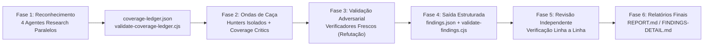

# 🔬 Guia da Metodologia de Auditoria Multi-Agente em 6 Fases

Este guia detalha o funcionamento do motor de auditoria em [`skills/security-audit/`](../skills/security-audit/SKILL.md), derivado e adaptado da arquitetura de descoberta de vulnerabilidades da Cloudflare ([*Build your own vulnerability harness*](https://blog.cloudflare.com/build-your-own-vulnerability-harness)).

---

## 1. Visão Geral da Arquitetura Multi-Agente

Em vez de pedir a um único agente que "procure vulnerabilidades" em prosa livre (o que gera cobertura rasa e falsos positivos), a skill orquestra subagentes isolados com papéis antagônicos bem definidos:



### Garantias Fundamentais do Fluxo

1. **Quem valida nunca é quem caçou:** Todo candidato proposto por um *hunter* na Fase 2 passa obrigatoriamente por um *verifier* independente na Fase 3 cuja instrução explícita é tentar **refutar** o achado no código-fonte e em sandbox local.
2. **Isolamento Estrito de Escrita:** Somente o agente coordenador (*parent*) grava nos arquivos compartilhados (`coverage-ledger.json`, `findings.json`, `REPORT.md`). Subagentes escrevem exclusivamente em `agents/<agent-id>/scratch/`, com promoção atômica anti-symlink (`O_NOFOLLOW`) para `artifacts/`.
3. **Separação entre Certeza e Prioridade:**
   - `confirmed`: Fronteira violada comprovada no código e com resultado local delimitado. Recebe severidade (`overall_severity` nunca maior que `impact.score`).
   - `needs_validation`: Hipótese fundamentada no código que depende de um fato externo não visível localmente (ex.: regra de WAF, IAM na nuvem, proxy). **Não recebe severidade especulativa**, registrando `blockers` exatos e `validation_plan`.
   - `rejected`: Candidato refutado, preservado no JSON para evitar repetição em execuções incrementais futuras.

---

## 2. Perfis de Execução (`quick`, `standard`, `deep`)

| Perfil | Granularidade do Ledger | Ondas de Caça e Críticos | Verificação Independente | Uso Recomendado |
| :--- | :--- | :--- | :--- | :--- |
| **`quick`** | `surface × boundary × attack_class` (subsistema agrupado) | 1 onda de hunters + 1 crítico final (lacunas marcadas `deferred`) | Fases 3 e 5 combinadas em 1 verificador independente por candidato | Repositórios pequenos, PRs rápidos ou triagem inicial |
| **`standard`** | `surface × boundary × subsystem × attack_class` | Múltiplas ondas até aprovação de crítico pós-onda + crítico final limpo | Fase 3 e Fase 5 executadas por agentes separados | Padrão recomendado para auditorias completas de projetos |
| **`deep`** | Adiciona dimensão `lifecycle` por subsistema | Ondas completas até crítico final limpo + repassagem em unidades de runs anteriores | Fase 3 e Fase 5 estritamente separadas + dupla checagem em substituições | Sistemas críticos, financeiros, multi-tenant sensíveis e pré-release |

---

## 3. Os 10 Domínios Especializados de Caça (*Hunting Companions*)

Durante a Fase 1, o coordenador seleciona apenas os guias de domínio cujas fronteiras realmente existem no repositório auditado:

| Arquivo em `skills/security-audit/` | Quando Selecionar | Controles Correlatos |
| :--- | :--- | :--- |
| [`AI-AND-LLM.md`](../skills/security-audit/AI-AND-LLM.md) | Chatbots, RAG, memória persistente, *tool calling*, MCP, prompts com input externo | `AI01–AI10`, `INT01–INT03`, `STK04` |
| [`WEB-PROTOCOL-AND-AUTH.md`](../skills/security-audit/WEB-PROTOCOL-AND-AUTH.md) | Apps web, APIs, proxies/CDNs, JWT, OAuth/OIDC, SAML, MFA, Passkeys, API keys, mTLS | `APP01–APP08`, `APP18`, `APP20`, `PRO01–PRO02` |
| [`CLIENT-SIDE.md`](../skills/security-audit/CLIENT-SIDE.md) | SPAs, React/Next.js, extensões, DOM sinks, `postMessage`, WebSockets, Service Workers | `APP07–APP08`, `STK02`, `CLI01` |
| [`DATA-ISOLATION-AND-LIFECYCLE.md`](../skills/security-audit/DATA-ISOLATION-AND-LIFECYCLE.md) | Bancos multi-tenant, caches, busca/vetores, export/backup, migrações, exclusão LGPD | `APP03`, `DB01–DB08`, `GOV01` |
| [`CLOUD-AND-DEPLOYMENT.md`](../skills/security-audit/CLOUD-AND-DEPLOYMENT.md) | IAM, Terraform/Helm/K8s, contêineres, Service Mesh, serverless/edge, buckets S3 | `INF01–INF06` |
| [`SUPPLY-CHAIN-AND-RELEASE.md`](../skills/security-audit/SUPPLY-CHAIN-AND-RELEASE.md) | Lockfiles, codegen, GitHub Actions/CI, assinatura SLSA/Cosign, atualizadores, plugins | `AI04`, `INF03` |
| [`PROTOCOLS-RPC-AND-MESSAGING.md`](../skills/security-audit/PROTOCOLS-RPC-AND-MESSAGING.md) | gRPC, Protobuf/Thrift, GraphQL transports, Kafka/RabbitMQ/SQS, webhooks, streaming | `APP16–APP17`, `PRO03` |
| [`RESOURCE-EXHAUSTION-AND-AVAILABILITY.md`](../skills/security-audit/RESOURCE-EXHAUSTION-AND-AVAILABILITY.md) | ReDoS, zip bombs, fan-out de queries, leaks de conexões/FDs, poison pills, cotas pagas | `APP12`, `AI06`, `STK03` |
| [`DESKTOP-MOBILE-AND-LOCAL-IPC.md`](../skills/security-audit/DESKTOP-MOBILE-AND-LOCAL-IPC.md) | Apps mobile/desktop, Electron/Tauri, deep links, bridges WebView, sockets/IPC local | `IPC01` |
| [`MEMORY-SAFETY-AND-BINARY.md`](../skills/security-audit/MEMORY-SAFETY-AND-BINARY.md) | C/C++, Rust `unsafe`, FFI/ABI, parsers nativos, loaders binários, JIT, kernel | `MEM01` |

---

## 4. Validadores Determinísticos Zero-Dependência

A pasta [`skills/security-audit/`](../skills/security-audit/) inclui dois validadores em Node.js puro (sem dependências externas `npm`), protegidos contra symlinks, FIFOs, JSON profundamente aninhado e injeção de caracteres de controle no terminal:

```bash
# Validar o ledger determinístico de cobertura (Fases 1 a 5)
node skills/security-audit/validate-coverage-ledger.cjs ~/security-audit-skill/meu-app/run-1/coverage-ledger.json

# Validar os achados contra o report-schema.json e regras semânticas (Fases 4 e 5)
node skills/security-audit/validate-findings.cjs ~/security-audit-skill/meu-app/run-1/findings.json

# Executar a suíte completa com os 65 testes automatizados dos validadores
node --test skills/security-audit/*.test.cjs
```
